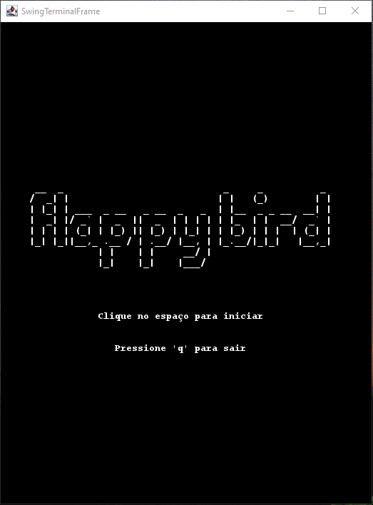
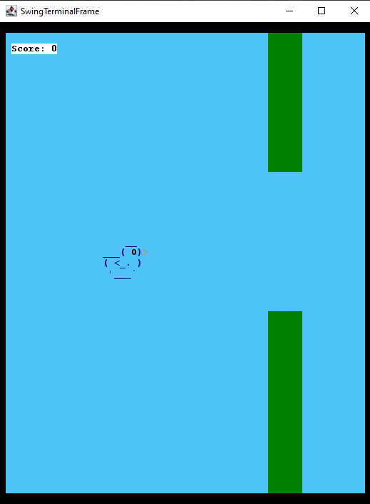
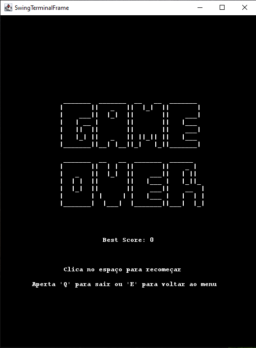
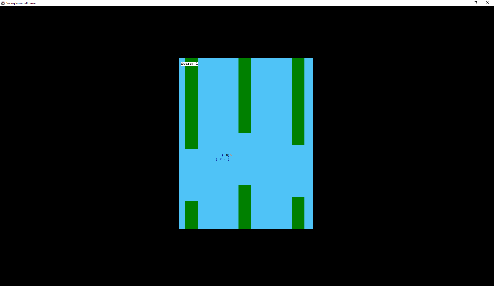

## Flappy Bird

Este jogo é baseado no jogo *Flappy Bird*. Basicamente o objetivo é passar o maior número de canos possível, no espaço entre os dois, onde é possível usar somente a *spacebar* que o faz voar.

## Sobre o Jogo
**Mecânicas do jogo**  
  
**Objetivo**: Passar pelo maior número possível de pipes sem colidir  
**Controlo**: Barra de espaço para fazer o pássaro voar  
**Física**: simulada com gravidade e velocidade (voo e queda)  
**Pontuação**: 1 ponto por cada pipe ultrapassado com sucesso  
**Best Score**: Sistema de persistência que guarda a melhor pontuação  
>O jogo foi feito na versão Amazon Corretto 1.8 no IntelliJ.  
  
**Seguem-se algumas screenshots do jogo:**  

**1–3. Flappy Bird – janela (início, gameplay e game over)**  

  
  
  

**4. Fullscreen**  

  

## Projeto
Além disto, pode acessar mais informação deste projeto, como:  

- UML: [Flappy Bird UML - jpg](uml/flappybird_uml.jpg) ou [Flappy Bird UML - Miro](https://miro.com/app/board/uXjVGVwjMw0=/?share_link_id=664194275074)
- Relatório: [Relatório  do projeto](Relatorio.md)

## Grupo

**Felipe Castilho** (a047152@umaia.pt)

**Juliana Moreira** (a047188@umaia.pt)

**Marta Vieira** (a046756@umaia.pt)
